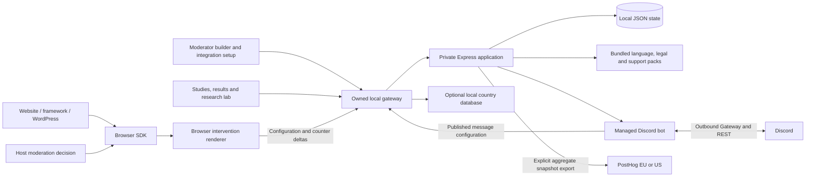

# Next Step architecture

Updated 8 November 2026. This describes the local technical prototype and its configured integrations.

## Runtime

`npm start` runs the built application through an owned gateway on loopback port 3000 and a private Express service on port 3001. Development adds Vite on port 3002. WordPress Playground and the second-origin installation fixture are separate local processes. The browser SDK and React package are built independently and included in downloadable archives.

Warning presentation runs in the browser. The host supplies the moderation decision through the SDK; the prototype includes a synthetic trigger rather than a production detector. The browser requests a frozen message configuration, renders it with local assets, and sends only allowed aggregate counter deltas. The same renderer serves authored previews and delivered messages.

The gateway is the application's entry point. It can derive a country hint transiently from a local IP-country database and forwards a country code to the private application. It does not forward the visitor IP or enable request logging. Country selection remains separate from language selection, and visitors can correct it. Dutch and English are complete; additional translations are previews. Reviewed Netherlands content is separate from editable warning copy.

## Authoring and publication

The moderator builder edits one installation's default intervention. It has a template library, journey stages, bilingual headline and body fields, and optional text, callout, pull-quote, list and divider blocks. Bounded appearance settings and layouts control presentation. Custom blocks contain text rather than arbitrary HTML, JavaScript or external asset URLs.

Saving updates the draft. Publishing validates both languages and creates an immutable snapshot. The browser renderer receives that snapshot; an already-open journey keeps its content version. Applying a template or undoing a change affects the draft until publication. Reviewed legal text and support-service routing stay separate from editable content.

Researchers author two to four variants and compare aggregate outcomes. New comparisons use automatic even assignment per exposure. Platform participation approves an exact published study version; publication does not silently replace an installation's approved version. Moderator pages contain installation and authoring controls, while study design and analytics remain in the researcher workspace.

## Data and research

The JSON store contains installations, drafts, immutable publications, studies and their publications, explicit participation, aggregate buckets and saved research-lab views. A bucket is keyed by installation, publication, variant, UTC day and source. It contains counters rather than original submissions or a list of visitor events.

Measures include stage reach, help-link selection, broad visible-duration bins, scrolling, information-end visibility and coarse step connections. Each connection is counted at most once within a browser exposure before its counter is added to the shared total. Connections cannot reconstruct an individual's route. Historical buckets gain zero-valued optional counters; the migration does not invent historical measurements or rewrite published messages.

Small counts and dependent rates are suppressed. Complementary totals are withheld where necessary. Demonstration assumptions and recorded synthetic interactions remain separate data sources. Counts describe exposures, not unique people; help clicks do not establish receipt of help.

The research lab provides configurable metrics, comparison and table views, a connection matrix, and saved views. PostHog is an optional server-side export destination. An explicit researcher action sends a reportable aggregate snapshot; it does not install a PostHog browser SDK, record sessions, forward submissions, or create visitor profiles. Suppressed values remain null. Exports carry a batch identifier, and the supplied query selects one snapshot to avoid adding repeated totals together. A project token is required to verify delivery to a real PostHog project.

## Discord and installation

The local application manages an official Discord bot. The deployment owner configures its application credentials once; a moderator uses Discord's OAuth2 bot-install authorization and finishes setup from the integration page. Native help interactions are ephemeral, bilingual and use published message copy. Discord still processes those interactions.

Readiness verifies the bot configuration, Gateway connection, server access, Manage Server permission, slash commands and the enabled bot-owned AutoMod test rule. A fresh authorized installation can complete the rule automatically. Explicit setup repairs only the owned rule and preserves its custom warning; ordinary startup does not re-enable a rule disabled in Discord. The test phrase is `test-trigger-red`. Discord exempts administrators and members with Manage Server.

The installation catalogue separates packaged adapters from platform-specific embed recipes. JavaScript, React, WordPress and Discord have runnable integration paths. Other frameworks and forums have explicit configuration and moderation-hook instructions; a guide does not imply that a separate native plugin has been shipped or independently exercised.

Optional Discord account connection is distinct from bot installation. It requires the deployment owner's OAuth client secret and a registered callback. The account flow uses state and PKCE; provider access tokens remain in server memory. It does not turn the seeded local workspace roles into production authentication.

## Storage and operational boundaries

| Location | Purpose |
|---|---|
| `.before/state.json` | Application state, publications, aggregate counters and saved views |
| `integrations/discord/.env` | Ignored local Discord configuration; credentials are never returned to the browser |
| `.before/posthog.json` | Protected server-side PostHog project configuration and last-export metadata |
| Bundled content and local country database | Translations, reviewed facts, service routing and optional country hints |
| `dist/` and `release/` | Built application, integration packages and review artifacts |

Private configuration files use restrictive permissions and are excluded from the source archive. Credential forms submit only to protected first-party administration endpoints; blank secret fields preserve existing credentials.

This is a local, single-owner demonstration with seeded moderator, researcher and presenter roles and a transactional JSON store. Production identity, multi-tenant authorization, database replication, a production detector, automatic legal-content review and broad native-adapter certification are separate deployment work. The actual verification scope is recorded in [VERIFICATION.md](VERIFICATION.md); ecosystem size and integration counts are documented in [COVERAGE.md](COVERAGE.md).
